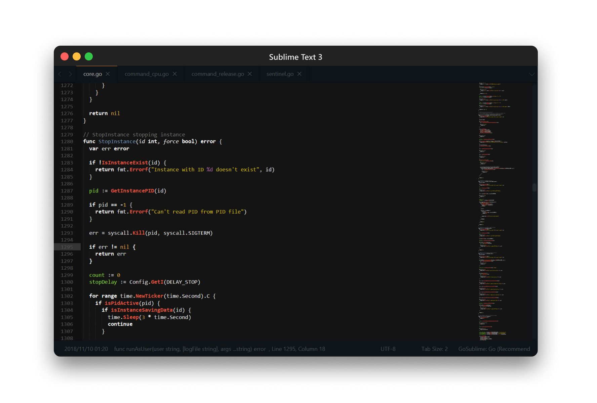

## 𝗕𝗟𝗔𝗖𝗞𝗛⬤𝗟𝗘 Theme for Sublime Text 3/4

<p align="center"><a href="#readme"></a></p>

### Screenshots



### Install

#### macOS

Open `Terminal.app` and do:

```bash
curl -OL# https://github.com/essentialkaos/blackhole-theme-sublime/archive/refs/heads/master.tar.gz -o blackhole-theme-sublime.tar.gz && \
  tar xzf blackhole-theme-sublime.tar.gz && \
  cp blackhole-theme-sublime-master/*.sublime-* "$HOME/Library/Application Support/Sublime Text/Packages/User/" && \
  cp blackhole-theme-sublime-master/*.tmPreferences "$HOME/Library/Application Support/Sublime Text/Packages/User/" && \
  rm -rf blackhole-theme-sublime*
```

#### Windows

Press <kbd>Win</kbd>+<kbd>R</kbd>, type `powershell` and press Enter. Then do:

```powershell
Invoke-WebRequest -Uri "https://github.com/essentialkaos/blackhole-theme-sublime/archive/refs/heads/master.zip" -OutFile blackhole-theme-sublime.zip
Expand-Archive -LiteralPath blackhole-theme-sublime.zip -DestinationPath .
Copy-Item -Path blackhole-theme-sublime-master\*.sublime-* -Destination "$HOME\AppData\Roaming\Sublime Text\Packages\User\"
Copy-Item -Path blackhole-theme-sublime-master\*.tmPreferences -Destination "$HOME\AppData\Roaming\Sublime Text\Packages\User\"
Remove-Item blackhole-theme-sublime* -Recurse
```

#### [`bat`](https://github.com/sharkdp/bat)

```bash
mkdir -p "$(bat --config-dir)/syntaxes" && cd "$(bat --config-dir)/syntaxes" && \
  curl -ZL --max-redirs 3 --parallel-max 5 --remote-name-all \
  https://raw.githubusercontent.com/essentialkaos/blackhole-theme-sublime/refs/heads/master/bibop-recipe.sublime-syntax \
  https://raw.githubusercontent.com/essentialkaos/blackhole-theme-sublime/refs/heads/master/knf.sublime-syntax \
  https://raw.githubusercontent.com/essentialkaos/blackhole-theme-sublime/refs/heads/master/rpm-spec.sublime-syntax \
  https://raw.githubusercontent.com/essentialkaos/blackhole-theme-sublime/refs/heads/master/ansible.sublime-syntax \
  https://raw.githubusercontent.com/essentialkaos/blackhole-theme-sublime/refs/heads/master/rbdef.sublime-syntax

mkdir -p "$(bat --config-dir)/themes" && cd "$(bat --config-dir)/themes" && \
  curl -ZL --max-redirs 3 --remote-name-all \
  https://raw.githubusercontent.com/essentialkaos/blackhole-theme-sublime/refs/heads/master/BLACKHOLE.tmTheme

bat cache --build && echo "--theme=BLACKHOLE" >> $(bat --config-file) && cd ~
```

### License

[Apache License, Version 2.0](https://www.apache.org/licenses/LICENSE-2.0)

<p align="center"><a href="https://kaos.dev"></a></p>
